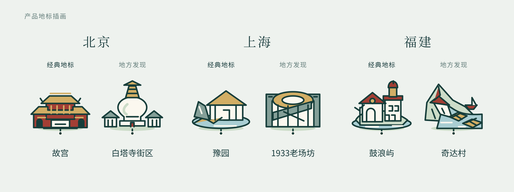

<p align="center">
  
</p>

<p align="center">
  一张收藏旅行照片、手记与重游故事的地图。<br>
  从想去的地方出发，把属于自己的回忆慢慢留下。
</p>

<p align="center">
  <a href="#从经典风景到街巷日常">发现地方</a> &nbsp; / &nbsp;
  <a href="#每次到访都值得留下">记录回忆</a> &nbsp; / &nbsp;
  <a href="#开始你的山海集">本地体验</a>
</p>

## 从经典风景，到街巷日常

认识一个地方，可以从熟悉的地标开始，也可以拐进一条安静的街巷。

山海集用原创地标图形，把「经典地标」与「地方发现」放在同一张可探索的地图上。从全国进入省区，随着放大逐层展开地点，寻找下一站，也认出走过的风景。

<picture>
  <source media="(max-width: 600px)" srcset="docs/assets/shanhai-landmark-gallery-mobile.svg">
  
</picture>

**34 个省区，175 处精选地点。** 云南已收录 43 处，其余 33 个省区各从 2 处经典地标、2 处地方发现起步，持续补充。分类依据地方特色与编辑选择，不代表实时热度或客流排名。

## 每次到访，都值得留下

### 照片，回到它发生的地方

为地点留下照片、日期和几句话。每段回忆支持最多 9 张照片，也能只写手记；同一个地方，可以收藏不同年份的重逢。

### 足迹，慢慢变成一本画册

照片叠片和精选封面，让地图有了自己的故事。地图里没有的小店或角落，也可以自己添加，记住它对你的意义。

### 用一句话，找回那一天

按地点、日期或手记搜索，在「我的足迹」里重看旅行。选几张照片与一段文字，做成可下载的回忆卡。

### 自己的回忆，自己留存

本机模式无需注册，照片与手记保存在当前浏览器。已保存记录可以导出备份，照片较多时也支持分卷与恢复。

**找一个地方 → 记下一次到访 → 积累自己的旅行地图。**

出发之前，也可以在「规划旅程」里选择地点，预览地点顺序与地图连线。它用于轻量选点，不提供道路导航或营业时间判断。

## 开始你的山海集

准备 Git 与 **Node.js 24.15+（24 系列）**，启动前端即可体验：

```powershell
git clone https://github.com/wcy-wcy1/Map.git
cd Map/shanhai-app
npm ci
npm run dev
```

打开 **[127.0.0.1:5173/app](http://127.0.0.1:5173/app)**。本机体验无需启动后端。

<details>
<summary><strong>关于照片保存与备份</strong></summary>

普通本机模式 `/app` 的照片与手记不会由应用上传。请保留原照片并定期备份：清理浏览器数据可能清除记录，更换浏览器、网址或端口时需要通过备份迁移。备份包含已保存照片、手记与封面，不含草稿。

</details>

<details>
<summary><strong>构建预览与开发资料</strong></summary>

在 `shanhai-app` 中执行：

```powershell
npm run build
npm run preview
```

打开 [127.0.0.1:5174/app](http://127.0.0.1:5174/app)。开发与预览使用不同端口，各自拥有独立的本机记录。`npm run build` 已包含地图工程的类型检查。

| 目录 | 内容 |
| --- | --- |
| [shanhai-app/](shanhai-app/) | Vue 3、TypeScript、Vite 与 Leaflet，地图与旅行记录前端 |
| [shanhai-api/](shanhai-api/) | NestJS、PostgreSQL 与 Sharp，本机账号和照片同步验证 |
| [docs/山海集/](docs/山海集/) | 产品设计、架构、数据契约与阶段性开发记录 |

完整 `npm test` / `npm run verify` 中的部分历史迁移与省界检查依赖未纳入 Git 的本机验收夹具，不属于干净克隆后一键可运行的检查。账号后端需要单独配置 PostgreSQL 和测试环境，详见 [后端启动说明](shanhai-api/README.md)。

历史设计与验收文档反映各自阶段，当前产品范围以本 README 与代码为准。

</details>

## 正在生长的旅行地图

目前为开发试用版，地图探索、照片手记、多次到访、回忆卡与本机备份均已实现。界面适配桌面与窄屏，移动端使用底部详情面板；真实 iOS / Android 设备兼容性还在继续验收。

接下来，我们会继续补充各地风景与地标细节，打磨地图缩放和手机交互，并推进正式账号与跨设备同步。`/connected` 目前仅用于本机测试账号联调；云端服务、AI 地标识别与 3D 景点展示仍属后续方向。

---

<sub>封面为品牌插画，地标画廊取自现有产品。地图轮廓为粗略示意，仅用于回忆定位。<a href="shanhai-app/public/data/SOURCES.md">地图资料与署名</a> · <a href="shanhai-app/reference/catalogue/README.md">精选地点与来源</a> · <a href="docs/assets/README.md">视觉素材说明</a></sub>
