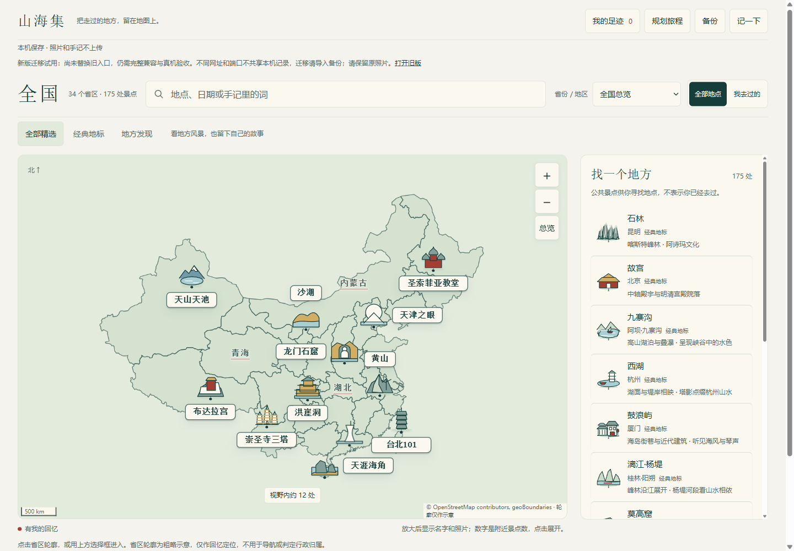
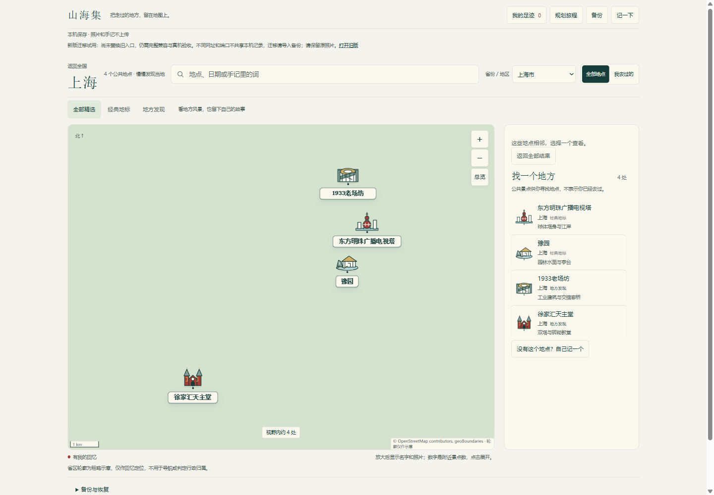

# 山海集

**把走过的地方，留在地图上。**

山海集是一款以手账地图为入口的旅行记录应用。把照片、日期和随手写下的心情放回它们发生的地方，让每一次出发、每一次重游，都成为可以翻看的回忆。

**34 个省区 · 175 处精选地点 · 经典地标与地方发现 · 照片与手记本机保存**



*当前版本实拍：从全国总览寻找一个地方，放大后展开地标与地点名称。*

## 一张地图，两种发现

有些地方，是第一次到访一座城市时就想去的；有些地方，适合慢下来，留意它的街巷、建筑与日常。

山海集将精选地点分为「经典地标」与「地方发现」，用具有当地辨识度的原创 SVG 图形呈现风景。从全国进入省区，再逐层展开附近景点，让地图随探索逐渐丰富。

| 经典地标 | 地方发现 |
| --- | --- |
| 从熟悉的代表风景开始认识一个地方 | 从街区、村落、建筑与自然角落发现地方性格 |
| 例如上海的东方明珠、豫园 | 例如上海的 1933 老场坊、徐家汇天主堂 |

当前目录保留云南 43 处地点，其余 33 个省区各精选 4 处，兼顾两种探索方式。分类来自编辑选择；「地方发现」强调地方特色，不代表实时客流或绝对冷门。



## 把风景变成自己的故事

- **给一个地方留下一段回忆。** 选照片、填日期、写几句话；也可以只写手记。每段回忆支持最多 9 张照片，同一个地方可以记录多次到访。
- **让地图长出自己的照片。** 用照片叠片回看足迹，为地点挑一张精选封面。公共景点帮你找地方，保存的回忆才构成「我的足迹」。
- **记录只属于你的地点。** 熟悉的小店、散步经过的角落，都可以通过自定义地点留在地图上。
- **从一句话找回一次旅行。** 按地点、日期或手记搜索，也可以只看「我去过的」，重新翻开某一段回忆。
- **把回忆做成一张卡片。** 选择照片、分享文字和日期，生成可下载的旅行回忆卡；支持的浏览器还可调用系统分享。
- **把记录带走。** 导出包含已保存照片、手记与封面的备份，需要时预检并恢复；照片较多时支持分卷备份。

另外，你可以用「规划旅程」选择想去的地点，预览地点顺序与地图连线。它适合整理出发前的想法，不提供道路导航或营业时间判断。

## 从第一段回忆开始

1. **找一个地方**：点击地图上的省区，或切换「经典地标 / 地方发现」。
2. **记下一次到访**：打开地点，添加照片、日期和手记；目录里没有的地方，也可以自己记一个。
3. **慢慢积累一张地图**：回看照片、搜索旧事、制作回忆卡，或导出备份继续保存。

普通本机模式 `/app` 无需注册，也无需启动后端。照片和手记保存在当前浏览器，不会由应用上传。请保留原照片并定期备份；清理浏览器数据可能清除记录，更换浏览器、网址或端口时需要通过备份迁移。备份包含已保存记录，不含草稿。

## 本地体验

准备 Git 和 **Node.js 24.15+（24 系列）**，在终端执行：

```powershell
git clone https://github.com/wcy-wcy1/Map.git
cd Map/shanhai-app
npm ci
npm run dev
```

打开 **[http://127.0.0.1:5173/app](http://127.0.0.1:5173/app)**，即可体验本机旅行地图。

如已在本仓库中，从 `cd shanhai-app` 开始即可。构建并预览发布版本：

```powershell
npm run build
npm run preview
```

预览地址为 [http://127.0.0.1:5174/app](http://127.0.0.1:5174/app)。开发与预览使用不同端口，各自拥有独立的本机记录。

## 产品进展

当前处于开发试用阶段，已具备全国精选地点、地标插画、地图探索、照片手记、多次到访、回忆卡与本机备份的完整体验。界面已适配桌面与窄屏，移动端使用底部详情面板；真实 iOS / Android 设备上的兼容性仍需继续验收。

接下来重点完善：

- 扩充各地精选地点与地标细节，让经典风景和地方特色更丰富。
- 持续优化地图缩放、密集地点展开与手机交互。
- 在现有本机账号联调基础上，推进正式身份系统与跨设备同步。

`/connected` 和后端目前用于本机测试账号联调；正式账号、云端服务、AI 地标识别与 3D 景点展示尚未作为正式产品能力提供。

## 开发与资料

| 目录 | 内容 |
| --- | --- |
| [shanhai-app/](shanhai-app/) | Vue 3 + TypeScript + Vite 前端，Leaflet 地图与原创 SVG 地标 |
| [shanhai-api/](shanhai-api/) | NestJS + PostgreSQL + Sharp，本机账号与照片同步验证 |
| [docs/山海集/](docs/山海集/) | 产品设计、架构、数据契约与阶段性开发记录 |

在 `shanhai-app` 中可执行常规构建检查：

```powershell
npm run typecheck:map
npm run build
```

完整 `npm test` / `npm run verify` 中的部分历史迁移与省界检查依赖未纳入 Git 的本机验收夹具，因此不属于干净克隆后一键可运行的检查。账号后端需要单独配置 PostgreSQL 和测试环境，详见 [后端启动说明](shanhai-api/README.md)。历史设计与验收文档反映各自阶段，当前产品范围以本 README 与代码为准。

地图轮廓为粗略示意，只用于回忆定位，不用于导航。地理边界与地点资料的来源、署名和许可见 [地图数据说明](shanhai-app/public/data/SOURCES.md) 与 [精选地点目录说明](shanhai-app/reference/catalogue/README.md)。
